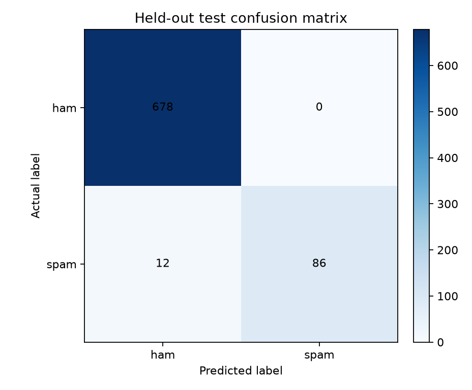
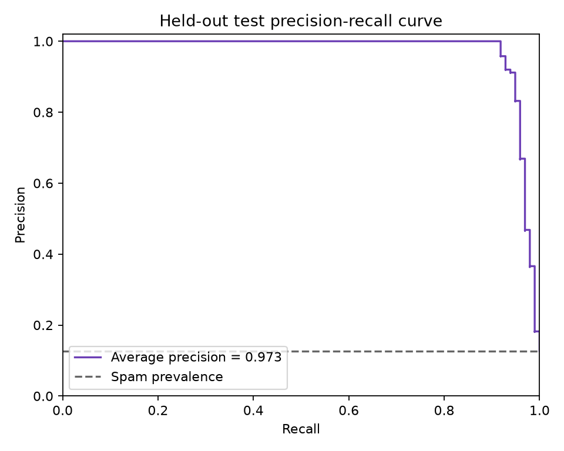

# Spam Message Classifier

A classic machine-learning SMS spam classifier using an offline preprocessing pipeline, Count/TF-IDF features, Multinomial Naive Bayes, and Logistic Regression.

## Dataset

Uses the official [UCI SMS Spam Collection](https://archive.ics.uci.edu/dataset/228/sms%2Bspam%2Bcollection). The raw copy has 5,574 messages; 403 exact duplicate rows were removed before the stratified split. The remaining 5,171 messages are split 70%/15%/15% into train/validation/test with seed 42.

## Setup and run

```powershell
python -m pip install -r requirements.txt
python -m spam_classifier.train
python -m spam_classifier.predict --text "Congratulations! You won a free prize, click now"
python -m spam_classifier.predict --interactive
pytest -q
```

## Held-out test metrics

Selected model: `tfidf_unigram_bigram_stop_removed_MultinomialNB`. Threshold `0.298678228883` was selected on validation to maximize spam recall subject to spam precision ≥ 0.98; validation constraint met: **True**. Test data was evaluated once after model and threshold selection.

PR-AUC (average precision): **0.972521** · ROC-AUC: **0.987900**

| Class | Precision | Recall | F1 | Support |
|---|---:|---:|---:|---:|
| ham | 0.982609 | 1.000000 | 0.991228 | 678 |
| spam | 1.000000 | 0.877551 | 0.934783 | 98 |

Confusion matrix in actual ham/spam rows and predicted ham/spam columns: `[[678, 0], [12, 86]]`.





## Cross-validation model comparison

All means and standard deviations below come from stratified five-fold CV on the training split only. Models are ordered by mean spam precision, with spam F1 used to break ties.

| Experiment | Spam precision mean ± SD | Spam recall mean ± SD | Spam F1 mean ± SD |
|---|---:|---:|---:|
| `tfidf_unigram_bigram_stop_removed_MultinomialNB` | 1.0000 ± 0.0000 | 0.8030 ± 0.0376 | 0.8903 ± 0.0238 |
| `tfidf_unigram_bigram_stop_kept_MultinomialNB` | 1.0000 ± 0.0000 | 0.7636 ± 0.0375 | 0.8655 ± 0.0245 |
| `tfidf_unigram_stop_kept_MultinomialNB` | 0.9973 ± 0.0060 | 0.7811 ± 0.0354 | 0.8757 ± 0.0216 |
| `tfidf_unigram_stop_removed_MultinomialNB` | 0.9899 ± 0.0139 | 0.8161 ± 0.0266 | 0.8943 ± 0.0114 |
| `tfidf_unigram_bigram_stop_kept_LogisticRegression` | 0.9865 ± 0.0159 | 0.7789 ± 0.0400 | 0.8699 ± 0.0250 |
| `count_unigram_bigram_stop_kept_LogisticRegression` | 0.9829 ± 0.0065 | 0.8796 ± 0.0291 | 0.9282 ± 0.0168 |
| `tfidf_unigram_stop_kept_LogisticRegression` | 0.9820 ± 0.0174 | 0.8096 ± 0.0319 | 0.8870 ± 0.0172 |
| `count_unigram_stop_removed_LogisticRegression` | 0.9783 ± 0.0098 | 0.8818 ± 0.0094 | 0.9275 ± 0.0066 |
| `count_unigram_stop_kept_LogisticRegression` | 0.9738 ± 0.0095 | 0.8884 ± 0.0261 | 0.9289 ± 0.0127 |
| `count_unigram_bigram_stop_removed_LogisticRegression` | 0.9730 ± 0.0153 | 0.8555 ± 0.0329 | 0.9101 ± 0.0186 |
| `tfidf_unigram_stop_removed_LogisticRegression` | 0.9711 ± 0.0205 | 0.7898 ± 0.0399 | 0.8704 ± 0.0230 |
| `count_unigram_bigram_stop_kept_LogisticRegression_balanced` | 0.9701 ± 0.0127 | 0.9146 ± 0.0213 | 0.9414 ± 0.0101 |
| `count_unigram_bigram_stop_removed_LogisticRegression_balanced` | 0.9650 ± 0.0137 | 0.9015 ± 0.0220 | 0.9320 ± 0.0142 |
| `tfidf_unigram_bigram_stop_removed_LogisticRegression` | 0.9647 ± 0.0176 | 0.7722 ± 0.0445 | 0.8572 ± 0.0287 |
| `count_unigram_stop_removed_LogisticRegression_balanced` | 0.9575 ± 0.0259 | 0.9190 ± 0.0100 | 0.9376 ± 0.0115 |
| `count_unigram_stop_kept_LogisticRegression_balanced` | 0.9529 ± 0.0089 | 0.9278 ± 0.0127 | 0.9401 ± 0.0074 |
| `count_unigram_bigram_stop_kept_MultinomialNB` | 0.9495 ± 0.0187 | 0.9387 ± 0.0198 | 0.9439 ± 0.0119 |
| `count_unigram_stop_kept_MultinomialNB` | 0.9430 ± 0.0204 | 0.9388 ± 0.0163 | 0.9408 ± 0.0168 |
| `count_unigram_bigram_stop_removed_MultinomialNB` | 0.9370 ± 0.0083 | 0.9431 ± 0.0092 | 0.9400 ± 0.0041 |
| `tfidf_unigram_bigram_stop_kept_LogisticRegression_balanced` | 0.9361 ± 0.0234 | 0.9518 ± 0.0099 | 0.9437 ± 0.0124 |
| `tfidf_unigram_stop_kept_LogisticRegression_balanced` | 0.9337 ± 0.0261 | 0.9453 ± 0.0077 | 0.9393 ± 0.0132 |
| `count_unigram_stop_removed_MultinomialNB` | 0.9288 ± 0.0149 | 0.9388 ± 0.0144 | 0.9336 ± 0.0095 |
| `tfidf_unigram_stop_removed_LogisticRegression_balanced` | 0.9012 ± 0.0283 | 0.9300 ± 0.0059 | 0.9152 ± 0.0162 |
| `tfidf_unigram_bigram_stop_removed_LogisticRegression_balanced` | 0.8491 ± 0.0501 | 0.9409 ± 0.0098 | 0.8920 ± 0.0290 |

## Stop-word ablation

Controlled CV ablation using the selected model/vectorizer/ngram configuration: stop words removed → spam precision 1.0000 ± 0.0000, F1 0.8903 ± 0.0238; stop words kept → spam precision 1.0000 ± 0.0000, F1 0.8655 ± 0.0245.

## Sample prediction log

The following lines are taken from `logs/sample_predictions.log`. Messages in the log are redacted unless `--log-raw` is explicitly used.

```text
2026-10-29T18:23:07+00:00 | Your UPI account is blocked. Share the OTP now to avoid suspension. => ham (spam_probability=0.1263, threshold=0.298678)
2026-10-29T18:23:07+00:00 | KYC expired today. Verify immediately at <URL> to keep your wallet active. => ham (spam_probability=0.2083, threshold=0.298678)
2026-10-29T18:23:07+00:00 | UPI refund pending. Pay Rs 2 verification fee to receive Rs 10000 now. => spam (spam_probability=0.3320, threshold=0.298678)
2026-10-29T18:23:07+00:00 | Congratulations! You won a lottery prize. Claim now by replying with your bank details. => spam (spam_probability=0.9028, threshold=0.298678)
```

## Deliverables

- `src/spam_classifier/train.py`: training, training-only CV comparison, validation threshold tuning, final held-out evaluation, plots, and reports.
- `notebooks/spam_classifier_walkthrough.ipynb`: concise reproducible workflow; `notebooks/spam_classifier_complete_project.ipynb`: full end-to-end, explained project notebook.
- `artifacts/pipeline.joblib`: fitted preprocessing and model pipeline; `artifacts/vectorizer.joblib` is the fitted vectorizer export.
- `artifacts/sha256-manifest.json` and `artifacts/model_metadata.json`: integrity manifest and model threshold metadata.
- `artifacts/metrics.json`, `artifacts/confusion_matrix.png`, and `artifacts/precision_recall_curve.png`.
- `docs/RESEARCH.md`, `docs/SECURITY.md`, and `docs/ANALYSIS.md`.

## Security and limitations

The prediction loader checks the fixed local artifact bundle against SHA-256 before joblib deserialization. Joblib is pickle-based: only load artifacts produced by this project in a trusted environment. Logs redact phone numbers, emails, and URLs by default, and inference has no network calls. Security details and test results are in [docs/SECURITY.md](docs/SECURITY.md).

The corpus is old, English-only, and does not represent modern Indian OTP/KYC/UPI/delivery scams. Demo examples are labeled **DEMO ONLY** and excluded from all metrics. Review [docs/RESEARCH.md](docs/RESEARCH.md) and [docs/ANALYSIS.md](docs/ANALYSIS.md) before relying on predictions.

## Security tool status

| Tool | Command | Result |
| --- | --- | --- |
| Bandit | `bandit -r src tests --skip B101,B105` | passed: No findings. B101 is excluded for pytest assertions. B105 is excluded because it flags scikit-learn's token_pattern=None configuration as a possible password; the source and tests were reviewed for credential assignments. |
| pip-audit | `pip-audit --skip-editable` | passed: No known vulnerabilities found in installed packages. The editable local project package is skipped because it is not published to a package index. pip 26.2.2 was installed before the audit. |
| pytest | `python -m pytest -q` | passed: 16 tests passed, including Unicode and punycode URL redaction and symlinked artifact destination refusal. |
